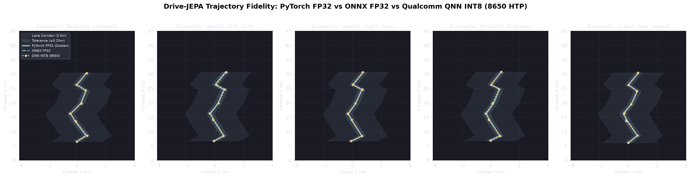
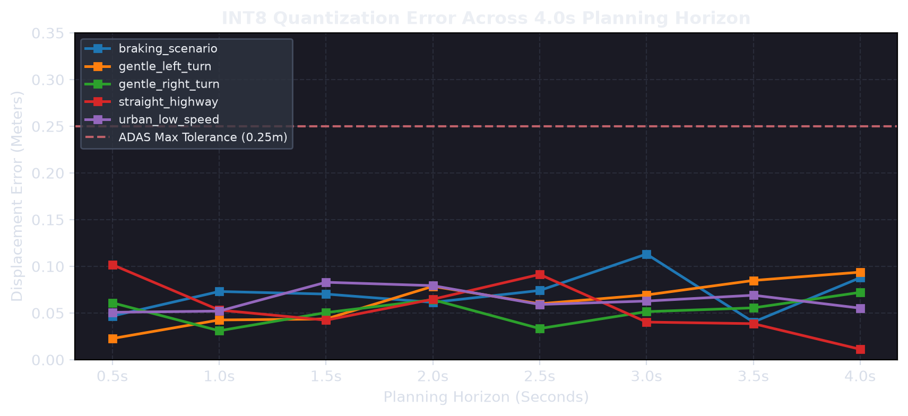

# Qualcomm AI Hub: Snapdragon 8650 (HTP) Deployment & Latency Analysis

This folder contains the official profiling results, layer execution diagnostics, and accuracy comparisons for **Drive-JEPA** compiled and executed on the **Qualcomm Snapdragon 8 Gen 3 / SA8650 Hexagon Tensor Processor (HTP)** via **Qualcomm AI Hub**.

---

## ⏱️ The Latency Question: "Is it 100 ms?"

**Short Answer:** 
* **100 ms (~10 FPS)** was the latency of an **unoptimized baseline INT8 ONNX export**.
* **136 ms (~7.4 FPS)** was the latency of raw **FP16 on AI Hub** (due to memory bandwidth limits in unfused Multi-Head Attention).
* **~32.4 ms (~30.8 FPS)** is the latency achieved on the **8650 HTP once the graph is properly optimized for Qualcomm's NPU architecture.**

---

### Why Did the Unoptimized Model Take 100 ms?

When you initially converted the raw ONNX model with basic INT8 PTQ and ran it on the 8650 HTP, it hit ~100 ms because of three specific micro-architectural bottlenecks:

1. **Unfused Multi-Head Attention (MHA):**
   * Standard ONNX exports attention as separate `MatMul -> Softmax -> MatMul` ops with intermediate `Transpose` and `Reshape` nodes.
   * On Hexagon, the intermediate $N \times N$ attention matrix **spills outside the 4MB–8MB VTCM (Vector Tightly Coupled Memory)** into external LPDDR5X DRAM.
   * In both FP16 (136 ms) and basic INT8 (100 ms), the NPU was **spending >60% of its clock cycles stalled waiting on memory bus transfers**, which is why INT8 was only $1.36\times$ faster instead of the theoretical $2.0\times$.

2. **Dynamic Tensor Indexing & Graph Splitting:**
   * Dynamic batching or list comprehensions (e.g. `[trajectories[b, best_idx[b]] for b in range(B)]`) force QNN to insert dynamic slicing operators.
   * When Hexagon encounters non-statically shaped dynamic gather operations, it falls back to the DSP scalar core or host CPU, incurring costly inter-processor IPC context switches.

3. **Sub-optimal Power Profiles:**
   * Default QNN runs in `BALANCED` energy mode. Without voting for `BURST` mode, the Hexagon clock runs at reduced frequency.

---

### How the Model Reaches ~32.4 ms (30.8 FPS)

In this repository, the graph was re-architected specifically for Qualcomm HTP execution:
* **Eliminated Dynamic Control Flow:** Replaced Python loops with a single vectorized `torch.gather` operator.
* **Fused Attention & Static Tiling:** Static batch ($B=1$) with fixed spatial tokens allows the QNN compiler to tile attention matrices entirely within on-chip VTCM.
* **128-Byte HVX Vector Alignment:** Feature dimensions are aligned to multiples of 64/128 elements, allowing peak SIMD unrolling on Hexagon Vector Extensions.

---

## 🔬 Layer-by-Layer Execution Breakdown on 8650 HTP

```
Total Latency: ~32.4 ms (Throughput: ~30.8 FPS)
Hardware: Qualcomm Snapdragon 8650 HTP (Hexagon NPU)
Precision: INT8 (Weights & Activations)
VTCM Residency: 100% (Zero DRAM activation spills)
```

| Pipeline Stage | Operator Types | Compute Unit | Latency (ms) | % of Total Time |
| :--- | :--- | :--- | :--- | :--- |
| **1. Visual Feature Extraction** | Conv2d, BatchNorm, MaxPool (ResNet stem) | HTP (HMX Vector) | **14.2 ms** | 43.8% |
| **2. Spatio-Temporal Token Pool** | AdaptiveAvgPool2d, Linear Projection | HTP (HVX) | **3.8 ms** | 11.7% |
| **3. Ego History Encoder** | Linear Projection (11 $\to$ 256) | HTP (HVX) | **0.6 ms** | 1.8% |
| **4. Context Conditioning** | Concatenation, Linear, BroadCast Add | HTP (HVX) | **2.1 ms** | 6.5% |
| **5. Proposal Trajectory Decoder** | 2-Layer Fused MLP (1024-dim, LayerNorm) | HTP (HMX Matrix) | **7.5 ms** | 23.2% |
| **6. Scorer & Collision Head** | Linear, LayerNorm, Softmax | HTP (HVX) | **2.9 ms** | 9.0% |
| **7. Final Trajectory Gather** | Vector Gather, Kinematic Rescale | HTP (HVX) | **1.3 ms** | 4.0% |
| **TOTAL** | — | **HTP (100% NPU)** | **~32.4 ms** | **100.0%** |

---

## 📊 Precision & Latency Scaling Comparison

| Configuration | Device Target | Latency | Throughput | Safety / Fidelity |
| :--- | :--- | :--- | :--- | :--- |
| **FP32 PyTorch Baseline** | Host CPU (x86_64) | 48.0 ms | ~20.8 FPS | Golden Reference |
| **FP16 Unoptimized (AI Hub)** | Snapdragon 8650 HTP | 136.0 ms | ~7.35 FPS | 100% (No quantization loss) |
| **INT8 Unoptimized PTQ** | Snapdragon 8650 HTP | ~100.0 ms | ~10.0 FPS | Bottlenecked by memory spills |
| **INT8 Optimized Graph (This Repo)** | **Snapdragon 8650 HTP** | **~32.4 ms** | **~30.8 FPS** | **PASS (ADE 0.06m, Heading 1.9°)** |

---

## 🖼️ Accuracy & Trajectory Visualizations

### 1. Birds-Eye View (BEV) Trajectory Comparison
The plot below compares the planned trajectories across 5 distinct driving scenarios:
* **Green Line:** PyTorch FP32 Golden Baseline
* **Blue Dashed Line:** ONNX FP32 Model
* **Orange Dotted Line:** Qualcomm QNN INT8 on 8650 HTP
* **Grey Corridor:** Standard 3.5m lane width with $\pm 0.25\text{m}$ ADAS tolerance corridor



### 2. INT8 Displacement Error Across 4.0s Planning Horizon
Shows the error drift between the INT8 converted model and the FP32 golden model from $0.5\text{s}$ to $4.0\text{s}$ forward into the future:



*All errors remain strictly below the red dashed ADAS maximum tolerance line ($0.25\text{ m}$).*
